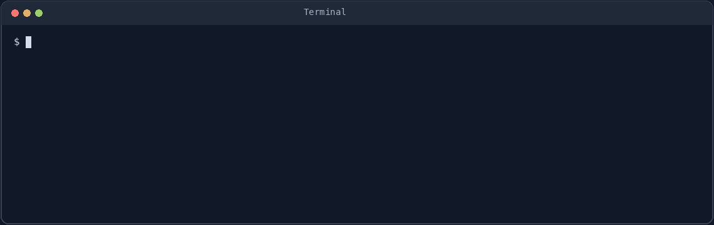

# cmdclass

cmdclass is an offline static analyzer for Bash/sh scripts and supported AWS calls in Python. It reports possible effects without running or changing the input.



Illustrated replay of actual CLI output; colors are added.

This proof of concept has coverage gaps, including dynamic behavior. An empty report does not mean a script is safe. Reports can contain sensitive filenames or arguments. Review them before sharing.

## Install

Requires Node.js 22.18.0 or newer. From the project directory:

```sh
npm ci --ignore-scripts
npm run build
npm install --global --ignore-scripts .
```

To uninstall, run `npm uninstall --global cmdclass`.

## Use

```sh
cmdclass --help
cmdclass ./script.sh
cmdclass ./script.py
cmdclass ./scripts
cmdclass --json ./scripts
```

Directory scans include `.sh`, `.bash`, `.py`, and extensionless files with a supported shebang. Hidden entries, symlinks, and directories named `node_modules`, `__pycache__`, `secrets`, or `credentials` are skipped. Files are analyzed independently; cross-file calls are not followed.

Findings are grouped by effect:

| Class | Meaning |
|---|---|
| DANGEROUS | Changes remote state, deletes local data, or creates credentials or access |
| SENSITIVE | Reads a secret or returns temporary credentials |
| UNKNOWN | The effect cannot be determined |
| LOCAL | Changes local state |
| READ-ONLY | A recognized read with no reported sensitive effect |

Exit codes are `0` for read-only or no findings, `1` for dangerous, unknown, or local findings, `3` for sensitive findings without exit-`1` findings, and `2` for usage, read, or parse errors. Directory scans report successful files alongside errors; errors take precedence.

Python subprocess launches retain an UNKNOWN finding. Some literal AWS commands and direct wrapper calls also receive a separate AWS classification; dynamic or unsupported command forms remain uncertain.

## Validate

```sh
npm run test:proof
```

See the [proof of working](./docs/proof-of-working.md) for test evidence and known gaps, and the [build prompt](./cmdclass-build-prompt.md) for scope and design details. Analysis uses the bundled AWS snapshot; `cmdclass --update-aws-data` explicitly refreshes it.
